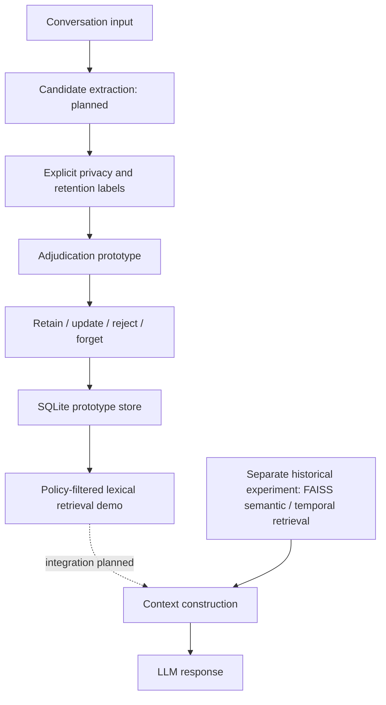
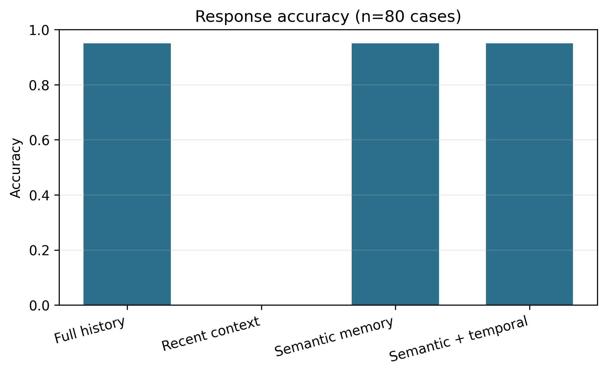

# Persistent Memory Architectures for LLMs

### Privacy-Constrained Memory Adjudication

**Research in progress · Experimental software · Public-benchmark evaluation pending**

An investigation of how conversational systems can retain useful information while respecting explicit privacy and retention restrictions. This repository preserves an existing synthetic context/retrieval experiment and adds a separate, tested prototype for retain/update/reject/forget decisions. It does not establish that privacy adjudication improves answer quality.

## Motivation and problem

Persistent memory can recover information outside a recent context window, but retaining everything also preserves obsolete, irrelevant or restricted information. The research question is whether an explicit adjudication stage can reduce inappropriate retention while preserving useful recall, and what it costs in tokens, storage and latency. Other questions concern conflicts, ageing history, retrieval scale and cases where privacy restrictions require abstention.

## Architecture and implementation



Solid prototype boxes operate on structured, trusted candidates; automatic extraction and integration into the historical inference pipeline are pending. `pmemory/` provides small policy, persistence and baseline interfaces. Existing `src/` and `experiments/` preserve the original FAISS/Ollama experiment.

## Adjudication and privacy constraints

Require explicit retention consent, an allowed purpose, a nonsensitive label and an unexpired retention window no longer than 30 days. A newer eligible fact updates the same owner/key; stale facts are rejected. Reads reapply policy, owner and purpose constraints. Forget logically deletes a row. These are functional rules over supplied labels, not automatic privacy detection. See [threat model and limitations](docs/privacy-and-threat-model.md).

## Evidence status

| Item | Status |
| --- | --- |
| Historical four-condition synthetic implementation | Implemented; unit tested |
| 320 historical model outputs | Preserved; inference not independently rerun |
| Historical score and uncertainty reanalysis | Recomputed from preserved outputs |
| Explicit-label privacy adjudication / SQLite | Experimental; unit tested |
| LongMemEval and LoCoMo loaders | Fixture tested; real-data validation pending |
| Mem0 baseline | Version-pinned interface; live reproduction pending |
| Privacy-constrained downstream comparison | Planned; no results |

[Detailed evidence audit](docs/research-audit.md) · [Research backlog](docs/roadmap.md)

## Historical experiment and results

The original experiment uses `qwen2.5:3b`, MiniLM embeddings, FAISS cosine retrieval and a semantic/temporal reranker. There are 100 authored synthetic cases in five categories: 20 pilot cases and 80 final cases. Reader temperature is 0, top-p 0.9, output limit 48 tokens, context setting 8,192 and generation seed 20260824. Pilot-selected retrieval uses k=3, alpha/beta=0.9/0.1 and decay 0.08/day. The full-history historical budget is 7,000 tokens; no final history was truncated.

| Historical condition | Correct / 80 | Accuracy | Mean input tokens |
| --- | ---: | ---: | ---: |
| Recent two turns, no external memory | 0 | 0.000 | 75.675 |
| Full history | 76 | 0.950 | 229.488 |
| Semantic retrieval | 76 | 0.950 | 195.300 |
| Semantic + temporal retrieval | 76 | 0.950 | 195.300 |

These are **preserved synthetic results**, not LongMemEval, LoCoMo, Mem0 or privacy-adjudication results. All targets were intentionally outside the recent window; its zero score follows from that design. Most candidate pools are no larger than k, so perfect retrieval recall provides weak evidence. Temporal reranking showed no answer/retrieval advantage here. Equal accuracy does not establish statistical equivalence or noninferiority.



Raw outputs and the original run remain in `results/` and `runs/`. Reanalysis produces Wilson accuracy intervals and stratified paired bootstrap differences in `results/reanalysis.json`. The synthetic cases are not a random population sample; intervals describe conditional case variability. Historical normal intervals and paired tests are retained as historical artifacts. No new inference, latency or cost measurements are implied by recomputing outputs. Original timing excludes preprocessing and fixed condition order confounds latency comparisons. There is no paid API cost measurement.

## Benchmarks and baseline methodology

[Benchmark guide](benchmarks/README.md) records inspected upstream commits, licenses, schemas, official scoring and setup boundaries. LongMemEval uses its official category-aware judge protocol, including abstention; LoCoMo uses category-specific QA rules and correlated conversation groups. Restricted data is not redistributed.

The planned controlled comparison includes a no-memory recent-context arm, a full-history control, unmodified Mem0 fact extraction, the proposed pipeline and an unconstrained ablation. Keep reader/version, prompts, token/retrieval budgets, splits and generation controls comparable. Disclose unavoidable extraction/store differences and account for their costs. A final Mem0 configuration and full benchmark runner are pending; this repository does not claim those baselines have run.

## Reproduction

Python 3.11 is the tested version. Fast tests need no model server or API credentials:

```bash
python3.11 -m venv .venv
source .venv/bin/activate
python -m pip install -r requirements-test.txt
python -m pytest -q
python tools/audit_preserved_results.py
```

The last command only audits existing outputs. Reproducing model generation is a separate operation:

```bash
python -m pip install -r requirements.txt
# Install/start Ollama separately, then: ollama pull qwen2.5:3b
python run_experiment.py dataset
python run_experiment.py pilot
python run_experiment.py final
```

Model downloads and full generation were not run during this preparation. Preserve a copy of `results/` first: historical orchestration updates canonical outputs. The [original experiment guide](docs/legacy-experiment.md) documents the existing runner. Model tags and two Hugging Face repositories were not revision-pinned in the historical run, so bit-for-bit reproduction is not guaranteed. `configs/evaluation.json` records missing future-run fields. Capture exact dependency locks, model digests, hardware and per-run manifests before a new comparison. Never run a paid reader or judge without cost authorization.

## Limitations and related work

Short synthetic templates, one reader, one embedding model, permissive substring answer scoring, a tiny candidate pool and fixed execution order limit the historical findings. The new prototype trusts consent/sensitivity labels, stores plaintext and provides no secure-erasure or formal privacy guarantee. No integrated privacy benefit, scale result or hardware claim is supported.

- [LongMemEval — Wu et al.](https://arxiv.org/abs/2410.10813): evaluating long-term interactive memory; use the official task definitions and judge.
- [LoCoMo — Maharana et al.](https://aclanthology.org/2024.acl-long.747/): very long-term conversational tasks; distinct dataset and metrics.
- [Mem0](https://github.com/mem0ai/mem0): existing memory extraction/update/retrieval system and planned baseline. No novelty or superiority over it is established here.

## Attribution, citation and publication

Project owner: **Abhishek Prajapati**. `CITATION.cff` describes research software, not a published paper. Confirm additional research/code contributors before public release. No DOI, acceptance, institution, patent status or publication is asserted. Licensing is pending an owner decision; no open-source license has been selected. Third-party benchmark/model terms are separate. Publication is gated on ownership, author attribution, dataset rights and the final safety review.
